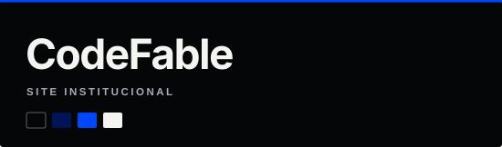
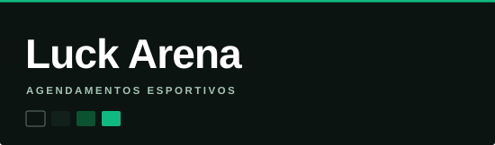
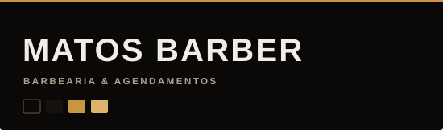
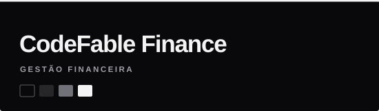

**Desenvolvimento de software com foco em produtos digitais, arquitetura e experiência de uso.**

Estudante de Engenharia de Software · Cofundador da **CodeFable**

[Projetos](#projetos-selecionados) &nbsp;·&nbsp; [Tecnologias](#tecnologias) &nbsp;·&nbsp; [Contato](#contato)

### Sobre

Sou estudante de **Engenharia de Software** na UniAteneu e técnico em Redes de Computadores. Na **CodeFable**, participo da concepção e do desenvolvimento de soluções web, desde o levantamento de requisitos e estruturação de sistemas até interfaces, dados e validação de funcionalidades.

Minha experiência com **atendimento direto a clientes e processos operacionais** contribui para entender problemas reais e comunicar soluções com clareza.

### Atualmente

- Atuação em atendimento e processos operacionais.
- Desenvolvimento de projetos web na **CodeFable**.
- Em busca de oportunidades como **Desenvolvedor Júnior**.

### Projetos selecionados

<table>
  <tr>
    <td width="50%" valign="top">
       
      <strong>Site CodeFable</strong> 
      Website institucional da marca, seus serviços e soluções digitais.
    </td>
    <td width="50%" valign="top">
       
      <strong>Luck Arena</strong> 
      Plataforma de reservas esportivas e gestão de horários.
    </td>
  </tr>
  <tr>
    <td valign="top">
       
      <strong>Matos Barber</strong> 
      Sistema de agendamentos para barbearias.
    </td>
    <td valign="top">
       
      <strong>CodeFable Finance</strong> 
      Gestão financeira pessoal e despesas compartilhadas.
    </td>
  </tr>
</table>

### Tecnologias

**Frontend**  
   

**Dados & infraestrutura**  
  

**Ferramentas**  
 

### Contato

**E-mail:** [lgustavo.oliveira123@gmail.com](mailto:lgustavo.oliveira123@gmail.com)  
**GitHub:** [github.com/lg-so](https://github.com/lg-so)  
**LinkedIn:** [linkedin.com/in/luis-gustavo0](https://www.linkedin.com/in/luis-gustavo0/)

